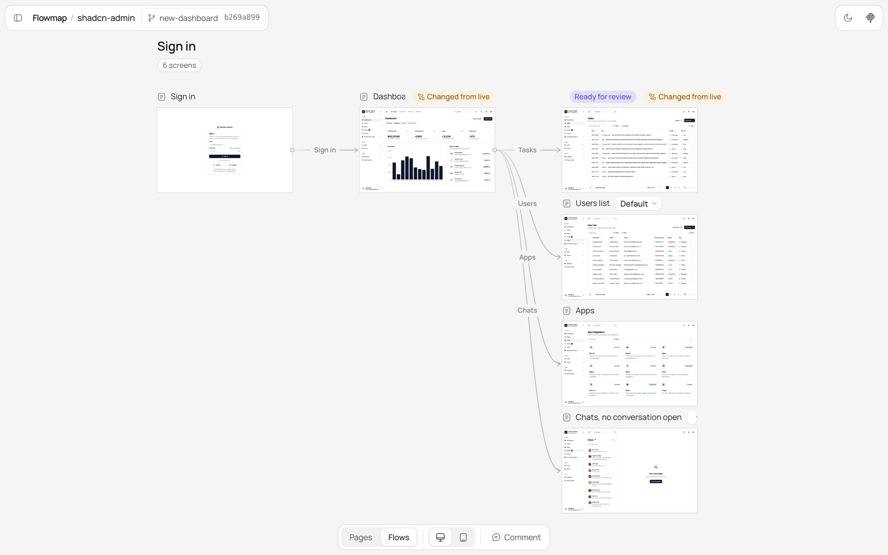
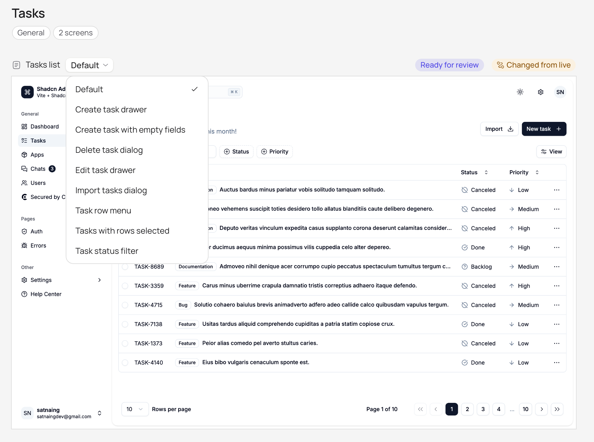
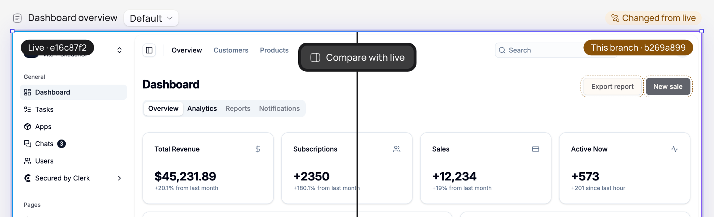
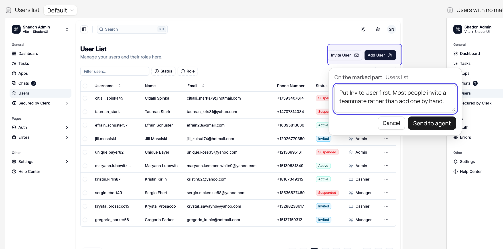
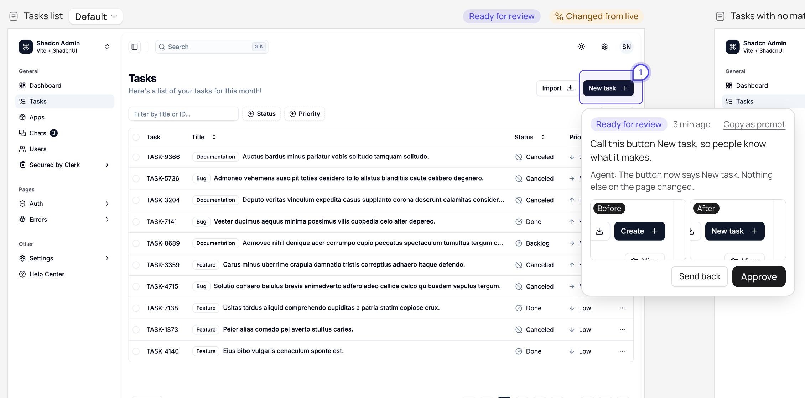
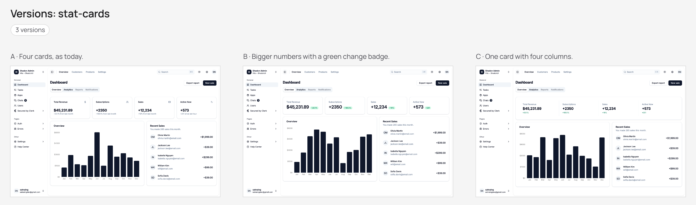
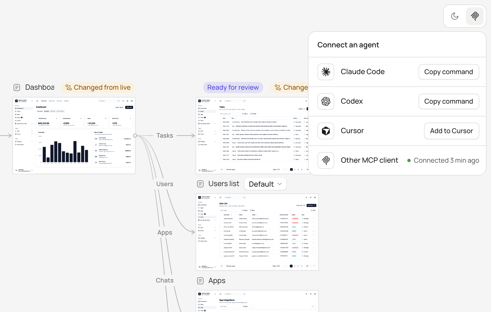

# Flowmap

[](https://www.npmjs.com/package/useflowmap)
[](https://github.com/Dammyjay93/flowmap/actions/workflows/ci.yml)
[](LICENSE)

See every screen of your web app as the code renders it, compare it with live, and send changes back to your coding agents.



## Quick start

Open your coding agent (Claude Code, Codex or Cursor) in your project and paste:

> Set up Flowmap: run `npx useflowmap setup` and do what it prints.

Your agent writes a recipe for each screen, starts your app and captures every screen. You watch them appear in your browser. Flowmap needs Node 22 or later and git.

## Every screen and every state

Each route, tab, dialog, empty state and step of a flow, signed in or not, captured from the code at a commit. Each page keeps its states in a menu, so a drawer, a dialog or a filter is one click away.



## Compare with live

Flowmap outlines what changed on each screen and names each element that was added, removed, moved or looks different. Drag between live and your branch.



## Mark what should change

Drag over a part of a screen and write what should change. Your agent gets it as a task, with the element under your mark.



## Review the agent's work

When the agent is done, see before and after side by side. Approve it, or send it back with a note.



## Versions side by side

Ask for several versions of a screen. They appear next to each other, and you choose one.



## A check before "done"

Before your agent says a change is done, it captures every screen again and sees each one its change touched, including the ones it did not mean to change.

```text
$ npx useflowmap check --base-url http://localhost:5410
Checked 461f5222 against e16c87f2
  dashboard at 1440: changed
    Added: Export report
    Added: New sale
    Removed: Download
  dashboard at 390: changed
    Added: Export report
    Added: New sale
    Removed: Download
  users at 1440: same
  users at 390: same
```

## Connect your agent

Flowmap runs on your computer, with no account. Connect Claude Code, Codex or Cursor in one step, and your agent learns how to use Flowmap from the server itself.



## Learn more

- [Reference](docs/reference.md): commands, MCP tools, state recipes, sign-in for captures, and settings.
- [Changelog](CHANGELOG.md): what each release changed.
- [Contributing](CONTRIBUTING.md): build Flowmap, run the tests and send a change.
- [Security](SECURITY.md): report a problem privately.

## Licence

MIT. The viewer's icons are [Solar](https://www.figma.com/community/file/1166831539721848736) by 480 Design, licensed [CC BY 4.0](https://creativecommons.org/licenses/by/4.0/). The agent logos are from [Simple Icons](https://simpleicons.org) (CC0). Each logo is a trademark of its owner.
